# Mantenimiento IPF — TP N° 3: Permisos móviles

App para que alumnos y docentes del Instituto Politécnico Formosa **reporten desperfectos del edificio** (una luz quemada, una canilla que pierde, un proyector roto) y **reciban un aviso cuando se resuelven**.

Está hecha con **Expo SDK 57 + Expo Router + TypeScript**. Usa **cámara, ubicación y notificaciones**, y elige fotos **sin pedir permiso de galería**. Cada permiso se pide **en el momento justo**, con una **pantalla previa**, y cada función tiene un **camino alternativo** si la persona dice que no.

- **Alumno:** Santiago Ayala
- **Materia:** Taller Complementario · React Native II — Tecnicatura Superior en Desarrollo de Software Multiplataforma
- **Respuestas de las Partes A a F:** [RESPUESTAS.md](RESPUESTAS.md)
- **Documentación de desarrollo (metodología SDD):** [spec.md](spec.md) (qué), [plan.md](plan.md) (cómo) y [tasks.md](tasks.md) (pasos)

---

## Índice

1. [Cómo ejecutar el proyecto](#1-cómo-ejecutar-el-proyecto)
2. [Árbol de carpetas](#2-árbol-de-carpetas)
3. [Tabla de permisos](#3-tabla-de-permisos)
4. [Configuración de `app.json` (plugins comentados)](#4-configuración-de-appjson-plugins-comentados)
5. [Mínimo privilegio: `blockedPermissions` justificados](#5-mínimo-privilegio-blockedpermissions-justificados)
6. [Auditoría del manifiesto (desafío opcional)](#6-auditoría-del-manifiesto-desafío-opcional)
7. [Cómo está organizado el código](#7-cómo-está-organizado-el-código)
8. [Capturas](#8-capturas)
9. [Pruebas realizadas y notas técnicas](#9-pruebas-realizadas-y-notas-técnicas)

---

## 1. Cómo ejecutar el proyecto

```bash
npm install
```

### En Expo Go (para probar la lógica)
El Expo Go del Play Store solo soporta el **último** SDK. Para este proyecto (SDK 57) hay que instalar **Expo Go 57** desde https://expo.dev/go (SDK 57 → Android). Después:

```bash
npx expo start --go
```

Escanear el QR **desde adentro de Expo Go**. En Expo Go los diálogos y permisos son los de Expo Go, no los de la app.

### En la development build (la app real)
```bash
npx eas-cli@latest build --profile development --platform android
```

Instalar el APK que genera EAS y después correr:

```bash
npx expo start
```

Abrir **Mantenimiento IPF** y elegir el servidor de la PC.

---

## 2. Árbol de carpetas

Cada archivo de `src/app` es una ruta (Expo Router):

```
src/app/
├── _layout.tsx                 Stack raíz (proveedor de reportes + manejador de notificaciones)
├── (tabs)/
│   ├── _layout.tsx             Barra de tabs: Reportes · Avisos · Permisos
│   ├── index.tsx               →  /                    Inicio: mis reportes y su estado
│   ├── avisos.tsx              →  /avisos              Bandeja de avisos (alternativa a notificaciones)
│   └── permisos.tsx            →  /permisos            Panel con el estado de cada permiso
├── reporte/
│   ├── nuevo.tsx               →  /reporte/nuevo       Formulario (no pide nada al abrir)
│   ├── escanear.tsx            →  /reporte/escanear    QR del aula (cámara, 4 estados)
│   ├── foto.tsx                →  /reporte/foto        Sacar foto (cámara) o elegirla (selector, sin permiso)
│   ├── ubicacion.tsx           →  /reporte/ubicacion   Ubicación en primer plano o sector a mano
│   └── [id].tsx                →  /reporte/[id]        Detalle + "Simular resolución"
├── permisos/
│   └── [recurso].tsx           →  /permisos/[recurso]  Pantalla previa al diálogo (modal)
└── ajustes-app.tsx             →  /ajustes-app         Interruptor "Avisarme cuando se resuelva mi reporte"
```

> `(tabs)` es un grupo: no aparece en la URL. `(tabs)/permisos.tsx` genera `/permisos` (el tab), y `permisos/[recurso].tsx` genera `/permisos/camara`, `/permisos/ubicacion`, etc., como modal encima de los tabs.

El resto del código está separado así:

```
src/
├── components/   piezas visuales reutilizables (botones, tarjetas, pantalla previa…)
├── hooks/        usePermiso, useRevisarAlVolver, useNavegarConPermiso, useReportes, useAvisarResolucion
└── lib/
    ├── permisos/        tipos, adaptadores por recurso, clasificación de estados, textos
    ├── notificaciones/  canal "reportes", programación del aviso, manejador
    ├── ubicacion/       obtenerUbicacion (precisa / aproximada / null)
    ├── fotos/           selector del sistema y cámara
    ├── reportes/        estado global (Context + reducer), validación, textos
    └── tema.ts          paleta, degradados y medidas
```

---

## 3. Tabla de permisos

| Recurso | Módulo | ¿Cuándo se pide? | Alternativa si se deniega |
|---|---|---|---|
| **Cámara** (escanear QR) | `expo-camera` (`useCameraPermissions`) | Al tocar **"Escanear QR del aula"** en el formulario, después de la pantalla previa. | Escribir el **código del aula a mano**. |
| **Cámara** (sacar foto) | `expo-image-picker` (`launchCameraAsync`) | Al tocar **"Sacar foto"**, después de la pantalla previa. | Elegir la foto con el **selector del sistema**. |
| **Fotos** | `expo-image-picker` (`launchImageLibraryAsync`) | **Nunca**: el selector del sistema no necesita permiso. | No aplica. La persona elige y la app recibe solo esa imagen. |
| **Ubicación** (solo primer plano) | `expo-location` (`requestForegroundPermissionsAsync`) | Al tocar **"Usar mi ubicación actual"**, después de la pantalla previa. | Elegir el **sector a mano** (patio, estacionamiento, pasillo…). Si es aproximada, se muestra "Ubicación aproximada" sin coordenadas. |
| **Notificaciones** | `expo-notifications` (`requestPermissionsAsync`) | **Solo** al activar el interruptor de `/ajustes-app`. En Android se crea antes el canal **"reportes"**. | Los avisos aparecen en la **bandeja `/avisos`**. |

Ningún permiso se pide al abrir la app ni de forma automática: siempre después de que la persona toca la función, y si dijo que no, la pantalla previa no vuelve a aparecer sola.

**Cómo se decide qué mostrar** ([src/lib/permisos/clasificarRespuesta.ts](src/lib/permisos/clasificarRespuesta.ts)):

| Respuesta del sistema | Estado en la app | Qué se muestra |
|---|---|---|
| `null` (todavía consultando) | `cargando` | Indicador de carga |
| `granted: true` | `concedido` | La función |
| `granted: false` y `canAskAgain: true` | `preguntable` | Pantalla previa con **"Continuar"** |
| `granted: false` y `canAskAgain: false` | `bloqueado` | Camino en Ajustes y **"Abrir Ajustes"** |

---

## 4. Configuración de `app.json` (plugins comentados)

`app.json` es la **fuente de verdad** de los permisos. Con `prebuild`/EAS se generan el `AndroidManifest.xml` y el `Info.plist`, que nunca se editan a mano. Los comentarios de abajo son solo explicativos, porque JSON no admite comentarios.

```jsonc
"plugins": [
  "expo-router",
  ["expo-splash-screen", { "backgroundColor": "#09110D", "image": "./assets/images/splash-icon.png", "imageWidth": 76 }],

  ["expo-camera", {
    // NSCameraUsageDescription (iOS): el texto que aparece dentro del diálogo.
    "cameraPermission": "Usamos tu cámara para leer el código QR del aula y sacar la foto del desperfecto que reportás.",
    // Mínimo privilegio: la app no graba video con sonido.
    "microphonePermission": false,   // sin NSMicrophoneUsageDescription en iOS
    "recordAudioAndroid": false      // sin RECORD_AUDIO en Android
  }],

  ["expo-location", {
    // NSLocationWhenInUseUsageDescription: el único que la app pide de verdad.
    "locationWhenInUsePermission": "Usamos tu ubicación para marcar en qué lugar del instituto está el desperfecto que reportás.",
    // Apple exige estas claves porque la librería contiene esas APIs, aunque la app nunca las llame.
    // Se reemplaza el texto genérico en inglés por uno honesto, para evitar el rechazo ITMS-90683.
    "locationAlwaysAndWhenInUsePermission": "Usamos tu ubicación solo mientras usás la app, para marcar dónde está el desperfecto. No la seguimos en segundo plano.",
    "locationAlwaysPermission": "Usamos tu ubicación solo mientras usás la app, para marcar dónde está el desperfecto. No la seguimos en segundo plano.",
    "motionUsagePermission": "Mantenimiento IPF no usa los sensores de movimiento de tu dispositivo.",
    // Sin segundo plano: no se agrega ACCESS_BACKGROUND_LOCATION ni el modo "location" de iOS.
    "isAndroidBackgroundLocationEnabled": false,
    "isIosBackgroundLocationEnabled": false
  }],

  ["expo-image-picker", {
    // NSPhotoLibraryUsageDescription: Apple la exige por la librería. La app no pide acceso a la galería.
    "photosPermission": "Usamos tus fotos solo cuando elegís una imagen del desperfecto para adjuntarla al reporte.",
    // Mismo texto que expo-camera (comparten NSCameraUsageDescription). Nunca `false`: bloquearía CAMERA.
    "cameraPermission": "Usamos tu cámara para leer el código QR del aula y sacar la foto del desperfecto que reportás.",
    "microphonePermission": false    // también bloquea RECORD_AUDIO en Android
  }],

  ["expo-notifications", {
    "color": "#1AA06D"               // color del ícono de la notificación en Android
  }]
]
```

Las notificaciones **no llevan texto de propósito** en iOS: se piden directamente. En `android.permissions` se declaran explícitamente CAMERA, ACCESS_COARSE_LOCATION y ACCESS_FINE_LOCATION, que son los mismos que agregan los plugins.

---

## 5. Mínimo privilegio: `blockedPermissions` justificados

`android.blockedPermissions` genera `tools:node="remove"`: quita el permiso del manifiesto final **aunque lo agregue una librería**.

| Permiso bloqueado | Quién lo agregaba | Por qué la app no lo necesita |
|---|---|---|
| `RECORD_AUDIO` | `expo-camera` y `expo-image-picker` | No se graba audio ni video con sonido: solo se lee un QR y se saca una foto. |
| `ACCESS_BACKGROUND_LOCATION` | `expo-location` (si se activa el segundo plano) | La ubicación se usa solo con la app abierta, para marcar el lugar del problema. Además, Google Play exige una declaración especial para el segundo plano. |
| `READ_EXTERNAL_STORAGE` | `expo-image-picker`, `expo-file-system`, `expo-image` | Las fotos se eligen con el **selector del sistema**, que no necesita permisos. |
| `WRITE_EXTERNAL_STORAGE` | `expo-image-picker`, `expo-file-system` | La app no guarda archivos en el almacenamiento compartido: la foto queda en la caché de la app. |
| `READ_MEDIA_IMAGES` | (Android 13+, librerías de galería) | Mismo motivo: selector del sistema. Google Play solo lo permite si la galería es la función principal. |
| `READ_MEDIA_VIDEO` | (Android 13+) | La app no trabaja con videos. |
| `READ_MEDIA_VISUAL_USER_SELECTED` | (Android 14+, acceso parcial a fotos) | No se pide acceso a la galería, ni total ni parcial. |
| `SYSTEM_ALERT_WINDOW` | Plantilla nativa de React Native / Expo | La app nunca se dibuja encima de otras apps. |

Comprobado en la development build: en **Ajustes → Apps → Mantenimiento IPF → Permisos** solo aparecen **Cámara, Ubicación y Notificaciones** (ver la captura `permisos-sistema`).

---

## 6. Auditoría del manifiesto (desafío opcional)

Salida de `npx expo prebuild --clean --platform android` (la carpeta `android/` se borró después, porque el proyecto usa CNG) y de los manifiestos de cada librería, que se fusionan al compilar:

| Permiso | Tipo | Quién lo agrega | ¿Queda en la app? |
|---|---|---|---|
| `INTERNET` | Normal | Plantilla, `expo-file-system`, `expo-image` | ✅ Sí (cargar el código en desarrollo) |
| `ACCESS_NETWORK_STATE` | Normal | `expo-image` | ✅ Sí |
| `VIBRATE` | Normal | Plantilla | ✅ Sí (vibración de la notificación) |
| `RECEIVE_BOOT_COMPLETED` | Normal | `expo-notifications` | ✅ Sí (conservar notificaciones programadas tras reiniciar) |
| `CAMERA` | Tiempo de ejecución | `expo-camera`, `expo-image-picker` | ✅ Sí |
| `ACCESS_COARSE_LOCATION` | Tiempo de ejecución | `expo-location` | ✅ Sí |
| `ACCESS_FINE_LOCATION` | Tiempo de ejecución | `expo-location` | ✅ Sí (la persona puede dar solo la aproximada) |
| `POST_NOTIFICATIONS` | Tiempo de ejecución (Android 13+) | `expo-notifications` | ✅ Sí |
| `RECORD_AUDIO` | Tiempo de ejecución | `expo-camera`, `expo-image-picker` | ❌ Quitado |
| `ACCESS_BACKGROUND_LOCATION` | Tiempo de ejecución | `expo-location` | ❌ Quitado |
| `READ_EXTERNAL_STORAGE` | Tiempo de ejecución (≤ API 32) | `expo-image-picker`, `expo-file-system`, `expo-image` | ❌ Quitado |
| `WRITE_EXTERNAL_STORAGE` | Tiempo de ejecución (≤ API 28) | `expo-image-picker`, `expo-file-system` | ❌ Quitado |
| `READ_MEDIA_IMAGES` / `READ_MEDIA_VIDEO` / `READ_MEDIA_VISUAL_USER_SELECTED` | Tiempo de ejecución | — | ❌ Quitados |
| `SYSTEM_ALERT_WINDOW` | Especial | Plantilla | ❌ Quitado |

---

## 7. Cómo está organizado el código

- **Hook unificado** [`usePermiso(recurso)`](src/hooks/usePermiso.ts): devuelve `estado` (`'cargando' | 'concedido' | 'preguntable' | 'bloqueado'`), `parcial` (fotos limitadas o ubicación aproximada), `pedir()` y `abrirAjustes()`. Solo **consulta** al montarse y nunca pide solo. Se actualiza al volver de Ajustes con [`useRevisarAlVolver`](src/hooks/useRevisarAlVolver.ts), que usa `AppState`.
- **Patrón Adapter + Registry:** cada módulo de Expo queda detrás de la misma interfaz `{ consultar, pedir }` ([src/lib/permisos/](src/lib/permisos/)). Para sumar un recurso nuevo alcanza con escribir su adaptador y agregar una línea en `registroAdaptadores.ts`.
- **Pedir en contexto:** [`useNavegarConPermiso`](src/hooks/useNavegarConPermiso.ts) va directo a la función si el permiso está concedido. Si no, abre la pantalla previa [`/permisos/[recurso]`](src/app/permisos/[recurso].tsx), que tiene **un único botón** ("Continuar" o "Abrir Ajustes") y ninguna opción "Ahora no" ni "Cerrar".
- **Estado global** con el patrón Provider (Context + `useReducer`) en [src/lib/reportes/ReportesProveedor.tsx](src/lib/reportes/ReportesProveedor.tsx). Las pantallas acceden por `useReportes()`.
- **Fachadas:** [`obtenerUbicacion`](src/lib/ubicacion/obtenerUbicacion.ts), [`programarAvisoResolucion`](src/lib/notificaciones/programarAvisoResolucion.ts) y [`moduloNotificaciones`](src/lib/notificaciones/moduloNotificaciones.ts), que es el único punto de acceso a `expo-notifications`.
- **Convenciones:** nombres en español sin tildes, `ñ` → `ni`; `export default` en componentes, hooks y rutas.

---

## 8. Capturas

> Tomadas en la **development build** de Android (app **Mantenimiento IPF** instalada con EAS).

### Escáner en sus cuatro estados
| Preguntable ("Continuar" + código a mano) | Bloqueado ("Abrir Ajustes") | Concedido (cámara leyendo el QR) |
|---|---|---|
| 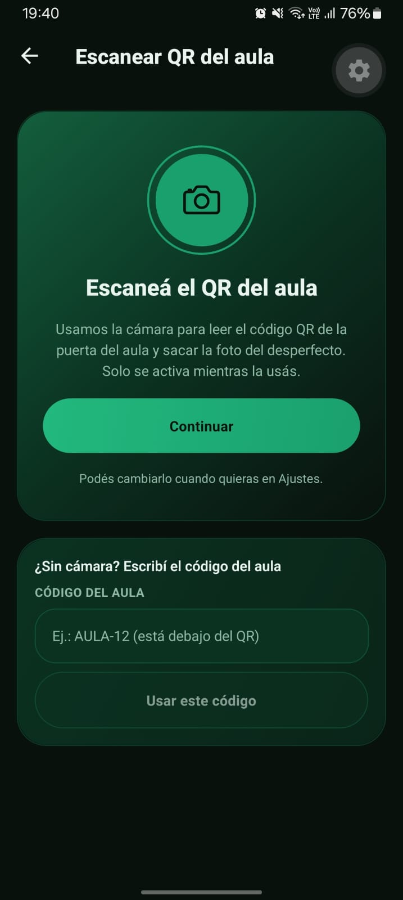 | 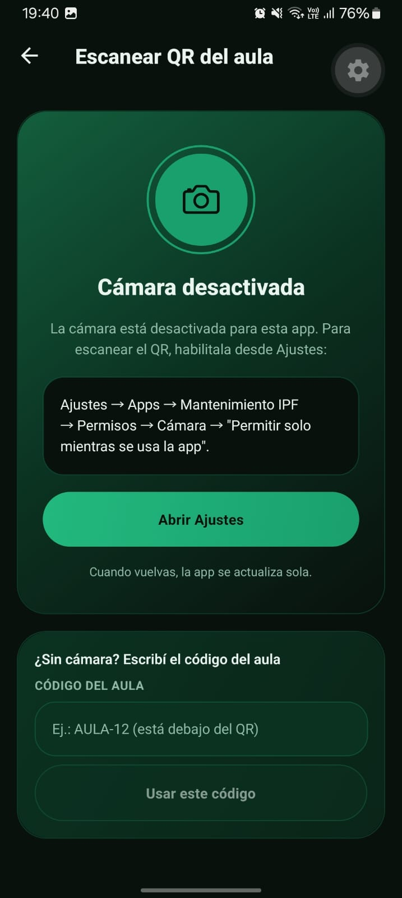 | 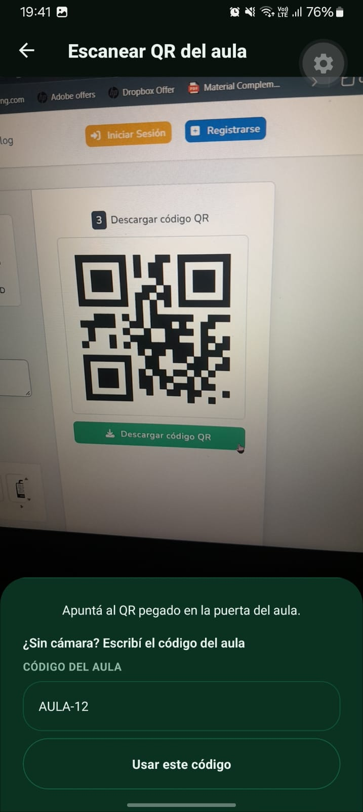 |

El cuarto estado, **cargando**, es el indicador que se ve una fracción de segundo mientras el hook consulta el permiso (`permiso === null`). Por lo rápido que pasa no se pudo capturar. Está en [src/app/reporte/escanear.tsx](src/app/reporte/escanear.tsx), en el `case 'cargando'`.

### Ubicación concedida y denegada
| Concedida (coordenadas) | Denegada (sector elegido a mano) |
|---|---|
| 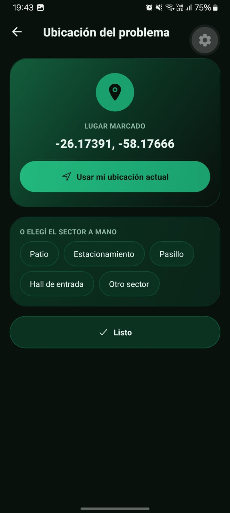 | 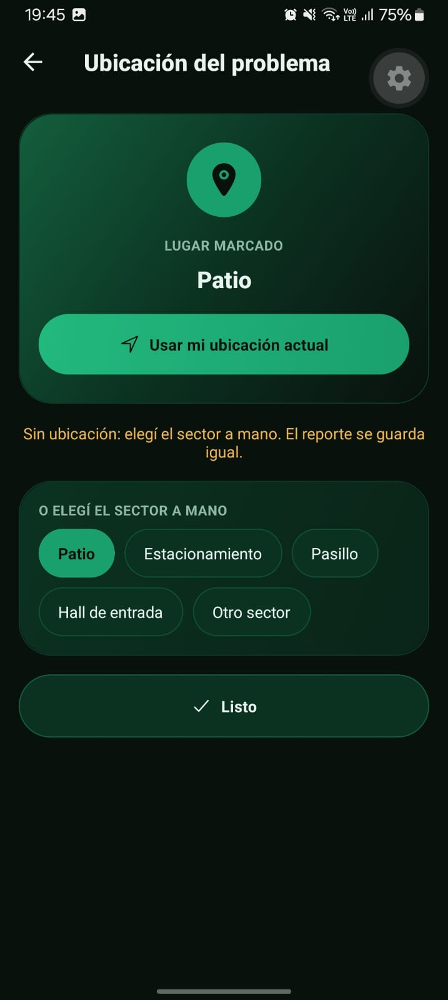 |

### Foto desde el selector del sistema (sin permiso)
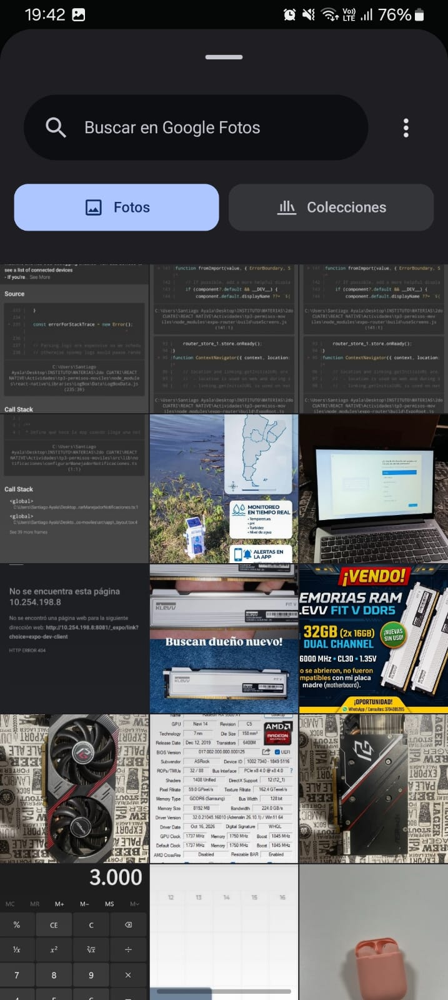

### Notificación recibida
| Notificación local a los 10 s de "Simular resolución" | En el panel de notificaciones del sistema |
|---|---|
| 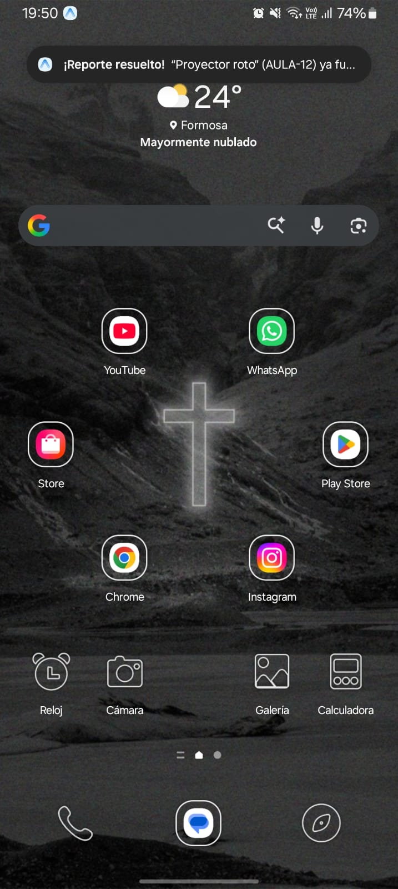 | 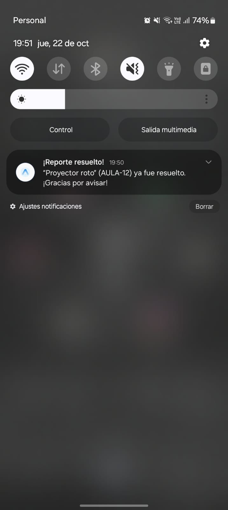 |

### Panel de permisos antes y después de volver de Ajustes
| Antes (ubicación bloqueada: `canAskAgain: false`) | Después de habilitarla en Ajustes (se actualiza sola, sin reiniciar) |
|---|---|
| 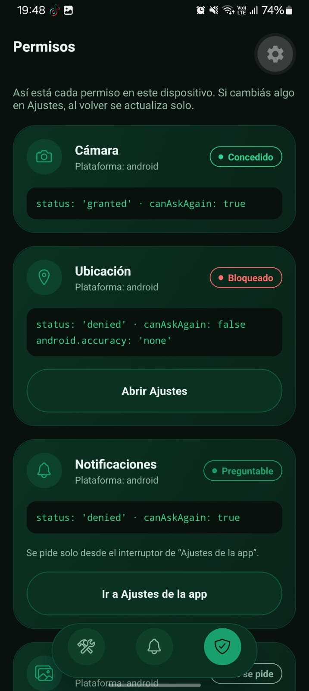 | 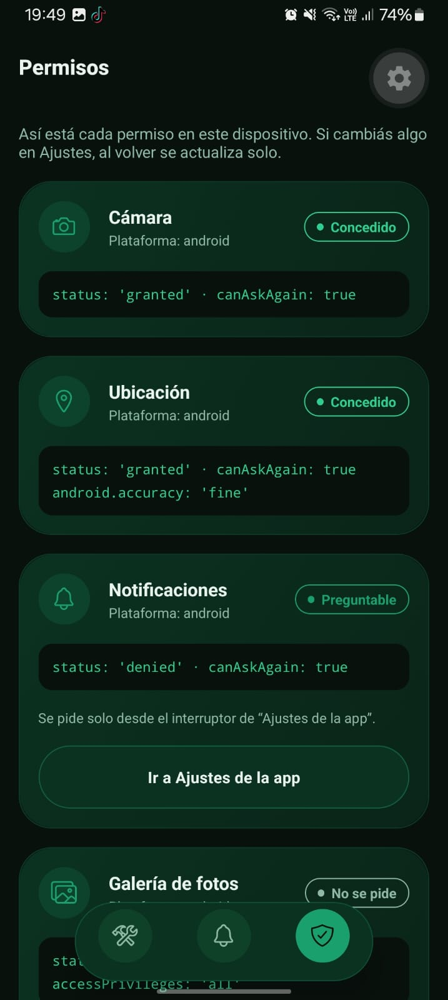 |

### Permisos de la app en el sistema (development build)
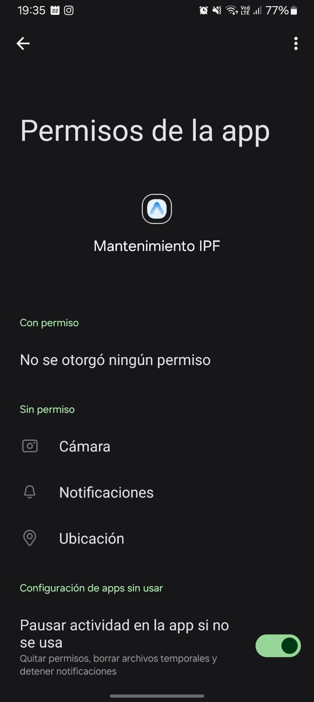

### Diálogo del sistema con nuestro texto de propósito
En **Android el diálogo de permisos no muestra texto propio**: lo arma el sistema. Por eso la explicación se da antes, en la pantalla previa. El texto de propósito (`NS…UsageDescription`) solo aparece dentro del diálogo de **iOS**. Para este trabajo no se contó con un iPhone ni una Mac para compilar la development build de iOS, así que esta captura no se pudo tomar. Los textos están configurados en los plugins de `app.json` (sección 4) y se aplican en la build de iOS.

---

## 9. Pruebas realizadas y notas técnicas

**Probado en:**
- **Expo Go 57.0.9** en Android: lógica de los 4 estados, pantallas previas, alternativas, notificaciones locales y vuelta de Ajustes.
- **Development build de Android** (EAS Build, perfil `development`): permisos propios, manifiesto real con `blockedPermissions` y canal de notificaciones "reportes".

**Calidad:** `npx expo lint`, `npx tsc --noEmit` y `npx expo-doctor` sin errores.

**Notas encontradas durante las pruebas:**
- **Expo Go y notificaciones.** Importar `expo-notifications` completo rompe Expo Go en Android: el índice carga un módulo nativo de push (`ExpoTopicSubscriptionModule`) que Expo Go ya no trae. Por eso toda la app usa [moduloNotificaciones.ts](src/lib/notificaciones/moduloNotificaciones.ts), que importa solo lo de notificaciones locales. Además, en Expo Go el canal "reportes" no se puede crear (el módulo nativo falla), así que ahí se usa el canal que ya trae Expo Go. En la development build el canal se crea normalmente, antes de pedir el permiso.
- **Android 9 o anterior.** `launchCameraAsync` también exige `WRITE_EXTERNAL_STORAGE`, que la app bloquea por mínimo privilegio. En esos equipos "Sacar foto" falla y la pantalla ofrece elegir la foto desde la galería.
- **Versión web.** El escáner de QR no usa la cámara en la web (necesita un archivo de un CDN externo), así que ahí se escribe el código del aula a mano. La app está pensada para móvil.

**Desafíos opcionales:**
- ✅ **Auditoría del manifiesto** (sección 6).
- ✅ **Bloqueo por plataforma:** la pantalla de "permiso bloqueado" muestra el camino exacto en Ajustes para Android o para iOS, según `Platform.OS` ([textosPermisos.ts](src/lib/permisos/textosPermisos.ts)).
- ⬜ Notificaciones provisionales de iOS y nota de voz con `expo-audio`: no implementados.
